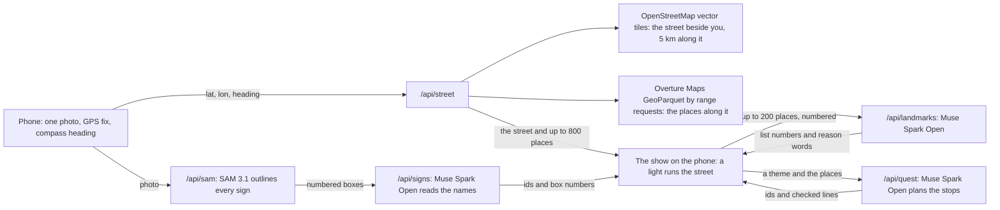

# What's Ahead

**One photo of a street, and the next 5 km of it on your phone: every place the map knows at its distance and on its side, the ones a visitor would know named by Meta's Muse Spark, and the signs in your photo found by SAM 3.1 and flown back onto the map.** An entry for the Meta Global AI Developer Hackathon (October to November 2026), built on Meta's models and Overture Maps.

**Try it** at https://whats-ahead.vercel.app (Chrome, Edge or Safari; on a phone on a street, Open camera). Away from a street, fly down one from the map alone: [Fifth Avenue](https://whats-ahead.vercel.app/?street=fifth-avenue) · [Hollywood Boulevard](https://whats-ahead.vercel.app/?street=hollywood-boulevard) · [Market Street](https://whats-ahead.vercel.app/?street=market-street) · [7th Avenue](https://whats-ahead.vercel.app/?street=7th-avenue) · [Michigan Avenue](https://whats-ahead.vercel.app/?street=michigan-avenue) · [Oxford Street](https://whats-ahead.vercel.app/?street=oxford-street) · [Champs-Élysées](https://whats-ahead.vercel.app/?street=champs-elysees) · [Ginza](https://whats-ahead.vercel.app/?street=ginza) · [Gangnam-daero](https://whats-ahead.vercel.app/?street=gangnam-daero).

<p>


</p>

*Fifth Avenue from 42nd Street on the deployment, 2026-10-30, from the map alone: the readings as the street comes in, the light stopping at a landmark, the whole street. A recording of the app taking a photo at Times Square and running 7th Avenue: [`public/demo/whats-ahead-loop.mp4`](public/demo/whats-ahead-loop.mp4) (photo by CartographDots on Mapillary, CC BY-SA 4.0).*

## At a glance

| | |
|---|---|
| **For** | Anyone on a street they do not know, visitors first: what is along it, how far on foot, on which side, which places are famous, and a short walk planned for the moment. Each place's card links its Instagram, Facebook page and website where the data has them. |
| **Meta's models** | **Muse Spark Open** (`meta-models/muse-spark-open-1026` on Baseten) picks the landmarks a visitor would know by name and the best known of each kind, plans a themed quest from the places it knows, and reads which mapped names show in the photo. **SAM 3.1** (Meta Model API) finds and outlines every sign in the photo; the outlines fly onto their places on the map. |
| **Data** | Streets from OpenStreetMap vector tiles, followed 5 km through junctions; places from **Overture Maps** (co-founded by Meta, most places from Meta's place data), read straight from its public GeoParquet release by HTTP range requests. No database; the server keeps nothing. |
| **Guardrails** | The models choose, the map tells: every name, distance and side on screen comes from the map. Muse Spark answers in list numbers, ids and words from fixed menus; its only free text, a quest's title and lines, is checked for digits, names and other scripts before the page sees it. Without the models everything still runs (the map's ranking, the app's own quest) and the page says which decided. |
| **Measured** | On the deployment, 2026-10-30: a street in 3.9 to 9.5 s when first asked, 0.2 to 0.5 s from the CDN; Muse Spark's landmarks in 4.5 to 7.1 s. Up to 800 places a street, the first kilometre first. |
| **Engineering** | A vector-tile decoder and a GeoParquet row-group index written for this project; a show drawn on a 2D canvas through its own perspective camera, with name tags kept off the street and off each other; walking with GPS fixes put on the street and smoothed by their accuracy; 145 unit tests and a live check of every demo street on the deployment (`npm run check:demo`). |



The project began as What If Camera, a building prototype that became What's Ahead on 2026-10-28 and was removed on 2026-10-30 (`DECISIONS.md` D11, D41); the old address, whatif-camera.vercel.app, still opens the same deployment (D43). Operator: Minwoo Kwon (`seegongsik`). License: all rights reserved (see `LICENSE`); third-party packages and data keep their own licenses, listed below.

Places are what OpenStreetMap and Overture Maps have mapped, shown with their sources; places change. Walking times and fame are estimates and judgements, shown as such (≈, ✦).

## How it works

The home page opens on a looping recording of the app (`public/demo/whats-ahead-loop.mp4`, 22 s, 2.5 MB; the page does not wait for it, the poster shows first): the camera on a real street-level photo of Times Square looking down 7th Avenue (a Mapillary photo by CartographDots, 2022, CC BY-SA 4.0; faces and plates blurred by Mapillary, a face on a billboard blurred by us; credited in the clip), the shutter, then the app itself taking that picture at Times Square and running 7th Avenue south with real map data (OpenStreetMap and Overture places as of 2026-10-31, credited in the clip): SAM 3.1 finds the signs in the photo, Muse Spark picks the landmarks the light stops at, and the street settles on your position. A finger then taps a bookshop near you, its card rises, and the finger taps its Instagram link; a caption card names the page the link opens (the clip does not show that page, which is someone else's). The recording is the app on the dev server of `main` with the deployment answering its API, in a headless phone-sized Chrome given the photo as its camera, the GPS fix and a compass heading of 209°; the finger and the photo's credit are drawn over it. Right under it comes Open camera, inside the first screen on any phone (on a short screen the clip shrinks to make room), then Continue on the last street from a photo when there is one, a line on what it does, Use a photo (a photo from the phone), a line on where the photo goes, and the demo streets, one per line. On a laptop or desktop (no touch screen) the first button flies down the first demo street instead, and Open camera moves next to Use a photo with a line saying the camera is for a phone on a street; the show itself stands in a phone-shaped column down the middle of a wide screen. The SYNTHETIC street is a small link at the bottom, under the credits: it is for a try without a photo, not a way in.


1. **Which street**: the photo's GPS fix and compass heading go to `/api/street`. The server reads OpenStreetMap's named roads around from OpenFreeMap's vector tiles (a CDN, so quick; the Overpass API only when the tiles cannot place the camera on a named street, and then for 5 s at most when the tiles did answer: from the deployment Overpass has seldom answered in time, and someone is waiting for the way out to a busier street) and picks the one that runs beside the camera in the direction it faces (pedestrian shopping streets included, which the tiles file as paths): within 40° of the heading, nearer and straighter first, main roads and named roads ahead of service lanes; within 45 m, or within 120 m when none is that near (a GPS fix between tall buildings is often that far off; the page then says how far). A starting point picked from the home page also sends the street's name, which picks it out. A phone that gives no compass reading (motion access refused, or a browser without an absolute compass) says so while you aim, and after the photo asks which of eight directions you faced; the camera readout marks a GPS fix wider than 35 m as rough.
2. **5 km ahead**: the route follows that road through every junction: the way that carries the same name (or road number) first, if it turns no more than 60°; otherwise the straightest one within 30°. It stops at 5 km, where the road ends, or where it turns back: a route that comes back more than 100 m toward where it started ends where it got farthest. The map's line for a divided road can go up one side and back down the other (Chuo-dori turns round at Nihonbashi), and a street can end around a square (Oxford Street at Marble Arch); followed on, the places across the road would come again on the way back, on the wrong side.
3. **Shops along it**: every named place within a corridor of the route (25 to 60 m each side by road class): food, cafés, bars, fashion, groceries, beauty, health, banks, things to do, places to stay and other shops. Each gets its distance along the street and its side. The places come from **Overture Maps** (the Overture Maps Foundation, which Meta co-founded; most of its places come from Meta's place data, so many have a Facebook page and a website), read straight from its public release; when Overture cannot answer, from OpenStreetMap. A street keeps at most 800 places, the first kilometre first: within 1 km (a walk of about 12 minutes) up to 600, beyond it at least 200, each part's most certain ones (then those with links), so the places you can walk to are not cut to make room for far ones (the busiest first kilometres hold 400 to 640: 7th Avenue, Fifth Avenue, Oxford Street, Ginza); a place mapped twice shows once.
4. **While it is worked out** (about 3 to 6 s, up to 6 s more for Muse Spark's picks): the photo is scanned top to bottom and folds into a dot, your position, on a radar: pulses, a compass turned to the map's north, the direction you face. Beside it the readings come in line by line, real values only: the photo's size, the GPS fix and its accuracy, the heading; then, when the server answers, the street and its road class, the route length, the number of places (and how many were found), the landmarks ("LANDMARKS · 7 · picked by Muse Spark · 3.2 s", or "by the map's ranking" when the model does not answer), the sources and any fallback taken, with the time the lookup took.
5. **The light**: the camera tilts from straight down to behind you and a light runs from your dot down the street, drawing it as it goes over a perspective grid. Every place lights up as a dot in its kind's colour when the light passes it, on its side of the street. At each landmark the light slows and the arrival lands with an impact: two rings run out over the ground from the place, it flashes, the picture washes with its colour for a moment and the camera punches in; its tag pops out of the dot with its name, distance and kind, and the name slides in large at the bottom like a film's lower third, with a sweep of light (phones that can vibrate give a short buzz). Tours use a lighter version. The camera chases the light with a lag, so the light shoots up the screen between landmarks and the camera settles on each one. A ruler on the right shows how far the light has got and how many places each stretch holds. Then the camera rises to show the whole street with its landmarks (about 10 s for 5 km; Skip jumps there). The run always starts at you, however long the readings waited for Muse Spark, and a stall (a phone busy for a moment, the tab out of sight) pauses the light rather than letting it jump ahead; a phone that is only slow keeps the pace with fewer frames. The frame is kept light for 60 frames a second: the dark ground and its vignette are the canvas's CSS background rather than painted every frame, tags are drawn once and stamped (text is the dearest thing to draw), grid lines too faint to see are not drawn, and the title is sized only when its name changes (the numbers under it change every frame). `?fps=1` puts a meter of frames per second on the show. Where nothing is mapped along the rest of the street (800 m or more after its last place), the show stops a little past the last place and the end's tag says how much street follows ("THEN 3.7 KM WITH NO PLACES"); across an empty stretch inside the street (500 m or more without a place, as a river crossing) the light runs four times as fast. Tags give places within 2 km in minutes on foot ("≈6 MIN", at 1.4 m/s, an estimate) and farther ones in kilometres; the card gives both.
   Name tags go on the place's own side of the street (a place on the left gets its tag to the left), stacked in a column on each side in the order of the places, facing the street, with a line back to the place. They keep clear of the street's line, behind the light and ahead of it, and of the caption at the bottom. Long names wrap onto two lines.
6. **Tours**: chips at the bottom (Restaurants, Cafés, Bars, Shops, Beauty, Entertainment, Hotels, Services, with their counts and a bar of the street's mix) send the light down the street again in that kind's colour, lighting only those places, counting them up and naming the best ones: the ones Muse Spark knows by name first (their tags carry ✦), then the map's ranking within the kind. "All" runs it again for every place. Tap a dot or a name for the place's card: kind, distance and side, hours as mapped, Instagram, Facebook and website links when the data has them, and the other places at the same spot.
   **Look closer**: once the light has run (touching the street while it runs takes it to the end), pinch or scroll to zoom about your fingers and drag to move. Seen whole, only the landmarks carry names, so the street is not buried in them; close in (a metre of ground over 0.3 px on the screen), every place in view gets its tag, those nearest the middle of the screen first, as many as fit (up to 18). A tapped place glides into the open space above its card (closer in when the street was seen from far), and no tag hides behind the card. The corners button goes back to the whole street; a chip or the replay hands the camera back to the show. Nothing moves while the street is being worked out.
7. **Landmarks** (Muse Spark Open): no visitor numbers or review counts exist in the data, so the model is asked which of the street's places a visitor would know or look for by name (famous sights, historic places, flagship stores, venues and restaurants known well beyond their block), most recognisable first, each with a reason from a fixed menu: iconic, historic, flagship, culture or well known. A chain's everyday branch is never one, however famous the brand (a coffee chain, a supermarket, a fashion chain's ordinary store): only a place famous in itself, as a brand's flagship. It sees up to 200 of the street's places (the map's best by its own ranking, and the best few of each chip's kind), by list number, name, kind and distance, and answers with list numbers and menu words only; every name, distance and side on screen is the map's. Its picks are kept at least 150 m apart, up to one per 600 m or so (three to eight), topped up from the map's ranking to three; their tags read "✦ ICONIC · 1.3 KM". The first run waits up to 6 s after the street is in (the deployment answered in 3.8 to 5.8 s on 2026-10-30); a later answer pops its landmarks up over the whole street one after another. Without an answer (no key, a quiet road with fewer than eight places, the SYNTHETIC street) the map's ranking decides, as before: a sight by its kind (museums, department stores and malls, theatres and cinemas, hotels), or a brand found only once on this street (more so with "flagship" or the street's own name in the place's name), then the source's confidence and links; chain restaurants, clinics, banks, guest houses and addresses ("608 Fifth Avenue") rank low. Answers are kept per server instance for six hours. A demo street's picks are asked for by GET (`/api/landmarks?demo=fifth-avenue`) as the show opens, alongside the street, and the CDN keeps them as it keeps the street (a day, then the stale answer while a fresh one is asked for; a street that fell back, with Overture or the tiles not answering, is not kept, nor the picks made for it); asked once there, the model reads up to 400 of its places. A tag too narrow for "✦ FLAGSHIP · ≈9 MIN" keeps "✦ ≈9 MIN" rather than cutting the time off.
8. **Signs in the photo** (SAM 3.1, then Muse Spark Open): while the street is looked up, SAM 3.1 finds every sign in the photo (the readings show "SIGNS · SAM 3.1 · 7 in your photo"). The app numbers the most certain twelve that are big enough to read (smaller ones are left out) from left to right in yellow boxes on a copy of the photo, and that copy goes to Muse Spark Open with the names of the nearest mapped places. The model says which names it can actually read in the picture, where (left, middle or right) and in which box. Read ones get a ✓ on their tags and cards and a line says "Right street, right way". Once the first run is over, the photo shows small at the top with SAM's boxes on it, the camera glides in over where you stood, and each read sign, cut out of your photo along SAM's outline, lifts out of its box and flies onto its place's dot, landing with a green ring and a tick while the place gets its name (about 4 s; a sign stands in the street a few metres from its shop, so the picture lands on the shop's mapped place, not where the sign stands). Without a box for a sign, or with reduced motion, the line comes with the read signs under it instead; the place's card shows its sign too. A photo of building fronts says what to try instead. The model answers with ids, box numbers from the photo and fixed words only; a box two places both name gives neither its picture.
   SAM only adds: the street, the light and everything else never wait for it. If SAM is off, fails or has not answered 3 s after the street is in, the sign check reads the plain photo as before. `SAM_DISABLED=1` on the server turns it off; `?sam=0` leaves it out of one visit.
9. **Quest** (Muse Spark Open): pick a theme (coffee and a browse, lunch break, evening out, rainy day, with kids, surprise me) and the model picks two to four stops along the street, in walking order, with a title and one line per stop. It reads up to 60 places within 2.5 km (name, kind, side, distance, mapped hours) and the street's name; the places it already named as landmarks are marked, and on the list wherever they are on the street and past the cap for their kind (up to 16), so a rainy day on Fifth Avenue can be the museums it knows 3 km up rather than the nearest shops. What it writes is checked before the page shows it: no digits, no listed name or brand, no other name it brings (a word with a capital inside a sentence, past a short list such as "Italian"), no sentence opening on a word of a listed name, English only; a title may be in title case but holds no word of a listed name. A line that fails is replaced by a plain one, a title by the theme's name. The light then runs to the stops in gold, numbered, with each stop's line under its name. Without the model the app picks the stops itself and says so.
10. **Walk it**: once the light has run on a street from the live camera, the dot follows your phone along the street: each GPS fix is put on the street (how far along, which side; a fix rougher than 100 m is left out) and the dot glides to it, so it neither jumps between tall buildings nor lags far behind. The camera follows a little behind and above you, your dot kept just above the bar and the buttons (on a short screen they cover the lower third), the stretch ahead is lit, the places behind dim, every place in view gets its name with its distance from you, and a bar says what is next ("Next: Dig Inn · 120 m on the right", how far along you are and the next landmark; on a quest, the next stop in gold, "Stop 2/4: …", the bar standing in for the quest's so only one bar sits over the buttons). Passing a landmark lights it up again with a short buzz. Off the street (50 m plus the fix's uncertainty, or past either end) the bar says how far away you are, and after 10 s offers a new photo where you stand. The screen stays on while walking (where the browser allows). Pinch or drag to look around; Follow comes back to you. Fixes stay on the phone: nothing is sent while walking. On a street from the map alone (the demo streets) Simulate, a walking figure beside Make a quest, offers a **SIMULATED** walk instead, labelled as such on the dot and the bar: fixes down the street at twenty times a walking pace, through the same steps.
    **The bottom of the screen**: at most one bar (a quest, or the walk), then Make a quest with two small tools beside it, an icon over a word (Simulate or Walk, Share), then the strip of kinds and the chips. The bars' own actions are round icons (replay, end, back to your dot). While the light runs (a replay, a chip's tour, a quest) the bottom fades to a third, so the street under it, your dot and the light's start, shows through; a touch brings it back.
    **Kept until the next photo**: a street from a photo (live or uploaded) is kept in that browser with Muse Spark's picks, without the photo. The home page offers Continue on it, and the page's address (`?resume=1`) brings the browser back to it after a reload, as when a phone reloads the page after a tap out to a place's Instagram: straight to the whole street, no run, the dot following you again if it came from the camera. A new photo replaces it.
11. **Share**: a 1080 × 1920 card in the same look (the whole street with its landmarks or the quest's stops in columns beside it, the count of each kind, the photo in a circle, the map's credits in full) through the phone's share sheet, for Instagram Stories, WhatsApp and the rest; saved as a picture where sharing files is not supported.

The street is drawn as a diagram, not a picture of it: its line and the distances along it come from the map; each place's dot stands on its side 8 to 24 m from the line (its mapped offset, kept in that range so dots neither sit on the line nor stray). Colours come from the kind of place, never logos. Without a photo, `/?street=lat,lon,heading[,name]`, a demo street by its id (`/?street=fifth-avenue`, the ids in `src/street/famous.ts`) or a demo street on the home page (streets the world knows by name: Fifth Avenue and 7th Avenue from Times Square in New York, Hollywood Boulevard from La Brea in Los Angeles, Market Street in San Francisco, Michigan Avenue in Chicago, Oxford Street in London, the Champs-Élysées from the Arc de Triomphe, Chuo-dori through Ginza in Tokyo and, last, Gangnam-daero in Seoul; those in the device's own time zone first, then its continent's; a demo street's heading is its name as the world knows it, "Chuo-dori · Ginza" for the map's 第一京浜) starts from the map alone; where no street is found, or the street has no places, the show offers the nearest of them; `/?demo=street` opens the SYNTHETIC street (invented street and shops, labelled SYNTHETIC). With reduced motion set on the device, the show goes straight to the whole street.

**When the phone holds something back**: links opened from KakaoTalk, LINE, NAVER, Daum, BAND, Instagram or Facebook land in that app's built-in browser, which often refuses the camera, location and compass; the home page then says so, with a button that opens the page in the phone's own browser where the app offers one (KakaoTalk, LINE) and the menu to use where it does not. A refused camera or location, a location that has not come after 8 s (the phone never asked: location off for that browser), or a fix that is only a rough area (wider than 1 km: on iPhone, Precise Location turned off; on a computer, a position from its network) shows the setting to change for the device and browser in hand: Safari or Chrome on iPhone, Android, and Chrome, Edge or Safari on a Mac or Windows, with the system's own switch when the site's is not enough (System Settings → Privacy & Security on a Mac, Settings → Privacy & security on Windows). The shutter waits until the fix is usable. While the browser opens the camera, and while it has still to ask for location, the page says to choose Allow and why; whenever location fails, the camera screen offers the first demo street and Use a photo, so a refusal is never a dead end.

**Field log**: every photo taken on the phone (live or uploaded) adds a line to a log kept in that browser only: the time, the GPS fix and its accuracy, the heading and where it came from, the tilt, the raw orientation values, then the street found (its name, road class, distance from you, direction, places, length) or why none was, the time the lookup took, and a `?street=` link that replays it from the map alone. The home page shows it under "Field log", with Copy and Clear; nothing is sent anywhere unless you copy it. It is there to look into a street that came out wrong after a walk.

## Models

| Role | Model | Where | Status |
| --- | --- | --- | --- |
| The landmarks and each chip's best-known places, by list number from the street's places, with a reason from a menu (iconic, historic, flagship, culture, well known) | `meta-models/muse-spark-open-1026` | Baseten | wired (`/api/landmarks`); the map's ranking without a key or an answer |
| Quest stops by id, the famous ones it knows first, with a title and a line per stop (checked for digits and names) | `meta-models/muse-spark-open-1026` | Baseten | wired (`/api/quest`); the app's own pick without a key |
| Which mapped places' names are readable in the photo, and in which of SAM's boxes | `meta-models/muse-spark-open-1026` | Baseten, OpenAI-compatible Chat Completions | wired (`/api/signs`); used when `BASETEN_API_KEY` is set |
| Every sign in the photo, as a box and an outline (prompt "sign"; "shop sign", "signboard" or "storefront" on request), numbered for the sign check and cut out for the place's card | `sam-3.1` | Meta Model API, Responses API | wired (`/api/sam`); used in the street view when `MODEL_API_KEY` is set, unless `SAM_DISABLED=1` |

When the models are configured, the photo (downscaled to 1024 px) and the nearest places' names are sent to them through the app's server, which keeps none of it; the providers' own terms apply to what they receive (Meta's free credits allow it to use what is sent to improve its products). The page says so where the photo is taken and on the home page. The landmark and quest requests carry the street's places (names, kinds, distances) and the street's position rounded to about a kilometre on the phone, and no photo. Muse Wonder is documented as unavailable in South Korea, so it is not used.

## Data

| Data | Source | License |
| --- | --- | --- |
| Streets: named roads (`transportation_name` layer) and, as a fallback, places with their kind (`poi` layer; offices and bike docks left out) | OpenFreeMap vector tiles (OpenMapTiles schema, zoom 14, up to 12 tiles along the heading) | ODbL; "© OpenStreetMap contributors · OpenMapTiles · OpenFreeMap" |
| Places along the street: name, kind (`basic_category`, `taxonomy.primary`), confidence, websites, socials (Facebook pages), brand, position | Overture Maps places, release 2026-10-21.0, GeoParquet in the public bucket `overturemaps-us-west-2`: only the row groups that meet the street (`server/data/overture-places.ts`, made by `node scripts/overture-index.mjs`) and only these columns, with HTTP range requests; confidence 0.5 and up, open places, street-level kinds | CDLA-Permissive-2.0, "Places © Overture Maps Foundation" on screen |
| Fallback street when the tiles cannot place the camera (roads with their nodes, `name`, `ref`), and shops when Overture is off (`shop`, `amenity`, `tourism`, `leisure` with `name`, `brand`, `opening_hours`, `cuisine`, `website`, `contact:instagram`, `contact:facebook`) | OpenStreetMap via the Overpass API (`overpass-api.de`, then `overpass.private.coffee`; boxes along the street; 20 s in all, 5 s when the tiles answered but had no named street). The answer's `notes` say why a fallback was used | ODbL, "© OpenStreetMap contributors" on screen |

## Assumptions

A compass within 40° of a street's direction means the camera looks along it; landmarks are Muse Spark's judgement from what it knows of the places (marked ✦ with its reason), or a ranking from what the map says (kind, brand, name, confidence, links), not a measure of visitors or reviews; the walking dot takes the GPS fix as it comes, smoothed along the street.

## Run locally

```bash
npm install
npm test          # street matching and following, places, landmarks and quests (prompts and checks), tags, walking, routes
npm run lint
npm run build
npm run check:api # transpiles the API functions file by file and calls them without keys
npm run dev       # http://localhost:5173/?demo=street (SYNTHETIC street), ?street=fifth-avenue (a demo street; needs the outside hosts); add &fps=1 on any page (the deployment too) to see frames per second
npm run check:demo # opens the nine demo streets on the deployment: checks them and fills the CDN where it runs (Vercel keeps a cache per region; run after each deployment); fails on a street that fell back, turns back, or has its places on one side
```

## Secrets and settings

Server side only; `/api/status` returns booleans.

| Variable | Use |
| --- | --- |
| `BASETEN_API_KEY` | Muse Spark Open on Baseten |
| `MODEL_API_KEY` (or `META_API_KEY`) | Meta Model API: SAM 3.1 (`/api/sam`) |
| `SAM_DISABLED` | `1` turns SAM 3.1 off; the sign check reads the plain photo |
| `OVERPASS_URLS` (or `OVERPASS_URL`) | Overpass API instances to try first, comma-separated, HTTPS only |
| `STREET_TILES` | `off` leaves out the OpenFreeMap vector tiles (streets then come from Overpass) |
| `OVERTURE_PLACES` | `off` takes the places from OpenStreetMap only |
| `DAILY_SPARK_CALL_CAP`, `DAILY_STREET_CALL_CAP`, `DAILY_SAM_CALL_CAP` | per-instance daily caps (defaults 300, 2000 and 1000); landmarks, quests and the sign check share the Spark cap, and a street's landmarks asked again come from the instance's cache or the CDN |

## Open source used

| Package | Role | License |
| --- | --- | --- |
| `hyparquet` | Reads Overture's Parquet files on the server (row groups and columns by range request; zstd through Node's own `zlib`) | MIT |
| `@meta-sam/parser` | Meta's reader for SAM 3.1's token text: boxes, and masks turned into SVG outlines (server) | SAM License |
| `vite`, `vitest` | build, dev server, tests | MIT |
| `typescript`, `typescript-eslint`, `eslint`, `@eslint/js`, `globals`, `@types/node` | types and lint | Apache-2.0 / MIT |

All application code was written in this repository during the hackathon (from 2026-10-27 02:00 KST).

| Media | Source | License |
| --- | --- | --- |
| The photo in the landing clip `public/demo/whats-ahead-loop.mp4` | Times Square, looking down 7th Avenue, 2022-04-05, by CartographDots on [Mapillary](https://www.mapillary.com) (Meta's street-level imagery); cropped to 3:4 and a face on a billboard blurred | CC BY-SA 4.0. The clip adapts it, so the clip itself is under CC BY-SA 4.0 (https://creativecommons.org/licenses/by-sa/4.0/); the rest of the repository is not |

## Limits

- Only what Overture Maps and OpenStreetMap have mapped, as they mapped it: coverage, names and opening hours vary by city, and shops close and open. The card says so and names the source.
- The street is matched from GPS and compass alone. On a corner or under tall buildings the GPS fix can sit on the cross street; the app shows which street it took (its name at the top, and how far from your position when it had to look wider), and the sign check says whether the photo fits it.
- A street that changes name keeps going only if the next way runs straight on; a dual carriageway mapped as two one-way roads is followed along the carriageway beside the camera.
- Roads without a name cannot be matched. When Overture cannot answer, places come from the map tiles and carry only their kind: no hours, links or brands.
- Overture's places are a monthly snapshot (release 2026-10-21.0; older releases leave the bucket after a few months, so the index is remade for a new one). Its place data has no opening hours; many places are on upper floors rather than at street level.
- Quest lines are ideas, not reviews: the model is told to state no menus, prices, exhibits or opening times; hours are as mapped and may be out of date. The sign check only knows names on the map: a sign it reads that the map lacks is not reported.
- Landmarks are a judgement, not visitor numbers: Muse Spark knows famous places well and small local ones hardly at all, its knowledge has a date, and it can only pick from the places it was shown (up to 200 of a street's 800 places; 400 on a demo street). A place the data puts in the wrong spot keeps its wrong spot, and a famous name draws the model's pick: Overture has "Palo Alto - Stanford Mall" 4.3 km up University Avenue in East Palo Alto and SFMOMA on Market Street, 700 m from the museum (the model picked both as iconic), so places known to be misplaced are left out by name and position, and a place the data names by its web address gets its name ("graumanschinese.org" is the TCL Chinese Theatre) (`src/street/errata.ts`); on the Las Vegas Strip most casinos sit on the street's line at the wrong block (Mandalay Bay 2.5 km north of itself), which is why the Strip is not a demo street.
- Walking follows the browser's GPS fix: between tall buildings it can be 30 to 50 m off (the dot glides, but along the wrong block for a while); it follows only while the page is open and in front (phones pause location for a page in the background); without a compass the camera follows the street's direction, not the phone's.
- Used on the operator's phones (also indoors: the street matches within 120 m without a photo); walking a busy street with the live dot is still to be recorded.
- The public Overpass servers are often full; the street comes from OpenFreeMap's vector tiles first, and Overpass is asked only when the tiles cannot place the camera on a named street.
